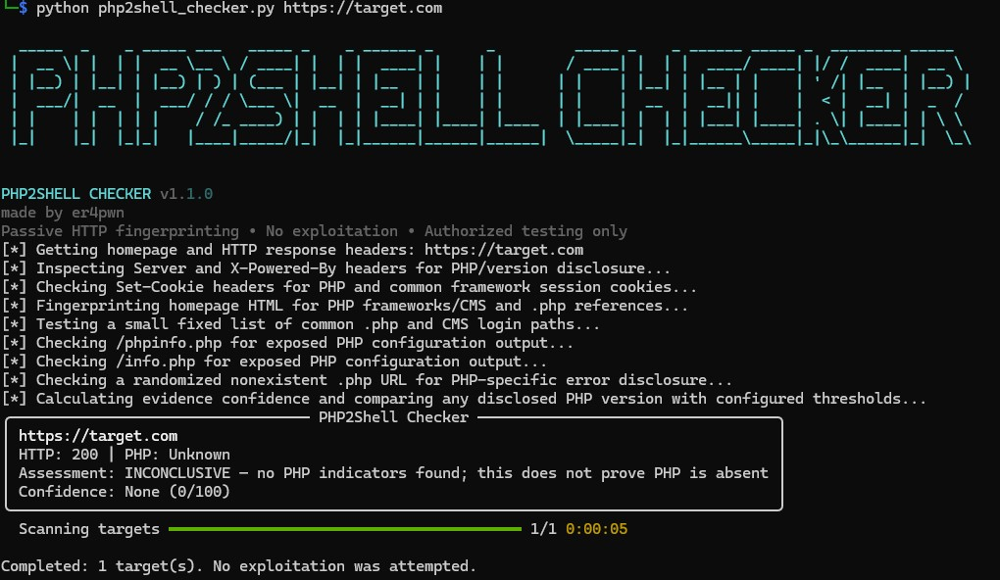

  
# PHP2Shell Checker

### Passive PHP Fingerprinting & Version-Based Vulnerability Assessment

**Developed by [er4pwn](https://github.com/er4pwn)**

PHP2Shell Checker is a Python-based security assessment tool designed to identify publicly observable indicators of PHP technologies and evaluate disclosed PHP versions against configured vulnerability thresholds. It performs lightweight HTTP fingerprinting to help penetration testers, security researchers, and vulnerability management teams identify potential PHP-related exposure across authorized web assets.

The tool combines HTTP response analysis, PHP session cookie identification, technology fingerprinting, common PHP endpoint checks, and PHP error signature detection into a single command-line workflow. It correlates the collected evidence with configured affected and fixed PHP version thresholds to provide an actionable, version-based assessment.

PHP2Shell Checker is designed for reconnaissance and defensive assessment. It does not attempt to exploit PHP2Shell, execute commands on target systems, or perform destructive testing.

---

## Table of Contents

- [Overview](#overview)
- [Key Features](#key-features)
- [Detection Methodology](#detection-methodology)
- [Version-Based Assessment](#version-based-assessment)
- [Installation](#installation)
- [Usage](#usage)
- [Command-Line Options](#command-line-options)
- [Output and Reporting](#output-and-reporting)
- [Understanding the Results](#understanding-the-results)
- [Limitations](#limitations)
- [Security and Responsible Use](#security-and-responsible-use)
- [Roadmap](#roadmap)
- [Contributing](#contributing)
- [License](#license)

---

## Overview

PHP remains widely used across web applications, content management systems, and server-side frameworks. Identifying PHP-powered assets and determining whether their disclosed runtime versions fall within a known affected range can help organizations prioritize further investigation and remediation.

However, PHP version information is not always exposed directly. Security assessments may need to correlate several observable indicators, including HTTP headers, session cookies, framework-specific patterns, `.php` references, and error responses.

PHP2Shell Checker automates these initial checks and consolidates the results into a single assessment.

### Project Objectives

- Identify observable indicators of PHP usage on web applications.
- Extract PHP version information when it is publicly disclosed.
- Detect common PHP-powered content management systems and frameworks.
- Identify potentially exposed PHP diagnostic pages and informative error responses.
- Compare disclosed versions against configured affected and fixed thresholds.
- Generate structured reports for security reviews and vulnerability tracking.
- Provide clear terminal feedback throughout the scanning process.

The tool is intended to complement, rather than replace, authenticated assessments, software inventory reviews, vendor advisory verification, and application-specific vulnerability validation.

## Key Features

### 1. HTTP Header Analysis

Inspect HTTP responses for technology disclosure through headers such as:

- `X-Powered-By`
- `Server`

When a PHP version is disclosed, the scanner extracts it and evaluates it against the configured version thresholds.

### 2. PHP Session Cookie Identification

Inspect response cookies for common PHP and PHP-framework session indicators, including:

- `PHPSESSID`
- `laravel_session`
- `ci_session`
- Other recognized framework-related cookie patterns

Cookie names provide supporting evidence only. They do not independently establish the server-side runtime or its version.

### 3. PHP Framework and CMS Fingerprinting

Look for recognizable indicators associated with popular PHP technologies, including:

- WordPress
- Drupal
- Joomla
- Laravel
- CodeIgniter
- Symfony
- Magento
- TYPO3
- Moodle

Detection relies on observable response content, paths, and cookie patterns. Results may be incomplete or inaccurate when applications customize their responses or use reverse proxies.

### 4. PHP Endpoint Discovery

Request a small, predefined collection of common PHP and CMS-related paths to identify observable endpoints and potential technology indicators.

Examples include:

- `/index.php`
- `/login.php`
- `/wp-login.php`
- `/phpinfo.php`
- `/info.php`
- `/test.php`

The scanner does not perform unrestricted directory brute-forcing or crawl every link on a target website.

### 5. PHP Information Page Detection

Check selected diagnostic paths for signatures consistent with PHP configuration output.

An exposed `phpinfo()` page may reveal runtime configuration, environment details, loaded modules, and PHP version information. The scanner records recognizable output signatures but does not execute PHP code or invoke operating-system commands.

### 6. PHP Error Signature Detection

Inspect selected responses for common PHP-related error patterns, such as:

- Fatal errors
- Parse errors
- PHP warnings and notices
- Uncaught PHP errors
- Stack trace indicators
- Undefined variable or function messages

A PHP-like error signature can provide useful evidence of technology exposure, but generic error text may also be produced by application templates or other components.

### 7. Live Scan Progress

Display informative status messages as checks are performed, including:

- Retrieving the homepage and HTTP response headers
- Inspecting PHP version disclosure
- Checking session cookies
- Fingerprinting framework and CMS indicators
- Testing predefined PHP paths
- Checking for PHP diagnostic output
- Inspecting error responses
- Calculating the final version-based assessment

### 8. Batch Scanning and Reporting

Scan multiple authorized targets using configurable concurrency and export results to:

- JSON for programmatic processing and integrations
- CSV for spreadsheets and vulnerability trackers
- HTML for readable assessment summaries

### 9. Configurable HTTP Behavior

Configure request timeouts, retries, delays, concurrency, User-Agent values, and an optional HTTP(S) proxy for controlled testing environments.

---

## Detection Methodology

PHP2Shell Checker uses multiple HTTP-level indicators to build a fingerprint of the target application.

### Phase 1: Homepage Retrieval

The scanner requests the target homepage and records relevant response metadata, including:

- HTTP status code
- Final URL after redirects
- HTML page title
- Server response header
- `X-Powered-By` header
- Response content used for fingerprinting

### Phase 2: PHP Version Identification

The scanner searches available response headers for PHP version strings.

When a version is extracted, the tool compares it with the configured affected and fixed thresholds for the corresponding PHP branch.

If no version is disclosed, the scanner continues collecting other indicators. An undisclosed version is not interpreted as evidence that the target is patched.

### Phase 3: Cookie and Technology Fingerprinting

The scanner inspects response cookies and page content for recognizable PHP-related patterns and framework indicators.

These observations help establish whether PHP may be in use, even when the runtime version is not directly disclosed.

### Phase 4: Predefined Endpoint Checks

The scanner requests a small set of predefined PHP and CMS-related paths, recording relevant HTTP responses and recognizable diagnostic output.

An HTTP status code alone does not prove that an endpoint exists or is generated by PHP. Results should be interpreted alongside response content and other evidence.

### Phase 5: Error Disclosure Checks

The scanner requests a randomized nonexistent `.php` path and examines the response for PHP-specific error signatures.

This check is intended to identify informative error handling. It does not intentionally trigger PHP execution or attempt to exploit a vulnerability.

### Phase 6: Evidence Correlation

The scanner consolidates the collected indicators, calculates a heuristic confidence score, and determines whether a disclosed PHP version matches a configured affected or fixed threshold.

The confidence score represents the strength of the collected fingerprinting evidence. It is not a probability of exploitation, a CVSS score, or a substitute for technical validation.

---

## Version-Based Assessment

The scanner currently uses the following reference thresholds.

| PHP Branch | Last Affected Version | Fixed Version Threshold |
|---|---:|---:|
| PHP 8.2 | 8.2.34 | 8.2.35 |
| PHP 8.3 | 8.3.35 | 8.3.36 |
| PHP 8.4 | 8.4.26 | 8.4.27 |
| PHP 8.5 | 8.5.11 | 8.5.12 |

These thresholds are supplied reference data and should be checked against the authoritative advisory before operational use.

### Assessment Rules

**VULNERABLE VERSION DETECTED**

The disclosed version falls at or below the configured last affected version for a supported PHP branch.

This is a version-based vulnerability indicator. Confirm that the deployed build and relevant component are affected before treating the finding as a confirmed exploitable vulnerability.

**NOT VULNERABLE BY VERSION**

The disclosed version meets or exceeds the configured fixed-version threshold for a supported branch.

This verdict applies to the version comparison only. Vendor backports, custom builds, inaccurate version disclosure, and other deployment details may affect the actual security status.

**INCONCLUSIVE**

The scanner cannot establish a decisive version-based result. This may occur when:

- PHP is detected but its version is hidden.
- No reliable PHP indicators are found.
- The disclosed version belongs to a branch without a configured threshold.
- The version cannot be parsed reliably.

An inconclusive result should not be interpreted as proof that the target is secure.

---

## Installation

### Requirements

- Python 3.10 or newer
- Network access to the authorized target systems
- Python packages listed in `requirements.txt`

### Clone the Repository

```bash
git clone https://github.com/er4pwn/php2shell-checker.git
cd php2shell-checker
```

### Create a Virtual Environment

On Kali Linux, WSL, or another Linux system:

```bash
python3 -m venv .venv
source .venv/bin/activate
```

On Windows PowerShell:

```powershell
python -m venv .venv
.venv\Scripts\Activate.ps1
```

### Install Dependencies

```bash
python -m pip install --upgrade pip
python -m pip install -r requirements.txt
```

### Verify Installation

```bash
python php2shell_checker.py --help
```

---

## Usage

### Scan a Single Target

```bash
python php2shell_checker.py https://example.com
```

A hostname can also be supplied without a scheme:

```bash
python php2shell_checker.py example.com
```

Hostnames without a scheme default to HTTPS. If the HTTPS request fails, the scanner does not silently downgrade to HTTP.

### Scan Multiple Targets

Create a file named `targets.txt` containing one hostname or URL per line.

```text
https://example.com
https://www.example.org
https://app.example.net
```

Run the scanner:

```bash
python php2shell_checker.py -i targets.txt
```

Blank lines and lines beginning with `#` are ignored.

### Generate JSON, CSV, and HTML Reports

```bash
python php2shell_checker.py \
  -i targets.txt \
  -o results.json \
  --csv results.csv \
  --html report.html
```

### Configure Concurrency

```bash
python php2shell_checker.py \
  -i targets.txt \
  -w 4 \
  --timeout 10 \
  --delay 0.25
```

Use conservative concurrency and request delays when assessing production systems.

### Use a Proxy

For an authorized test environment, traffic can be routed through a local HTTP proxy:

```bash
python php2shell_checker.py https://example.com \
  --proxy http://127.0.0.1:8080
```

Ensure that the proxy is configured appropriately and that certificate validation remains enabled wherever possible.

### Handle TLS Certificate Errors

If a target's certificate chain cannot be validated, the scanner may be unable to complete the HTTP checks.

Prefer correcting the system CA trust store or using an appropriate trusted CA bundle. The current version also supports an explicit option to disable TLS verification:

```bash
python php2shell_checker.py https://example.com --no-verify-tls
```

Disabling TLS verification weakens connection security and should be reserved for controlled troubleshooting or authorized test environments.

---

## Command-Line Options

| Option | Description |
|---|---|
| `-i, --input FILE` | Read targets from a file |
| `-o, --json FILE` | Write JSON output |
| `--csv FILE` | Write CSV output |
| `--html FILE` | Write HTML output |
| `-w, --workers N` | Number of concurrent target scans |
| `--timeout SECONDS` | HTTP request timeout |
| `--delay SECONDS` | Delay between requests per worker |
| `--retries N` | Connection retry count |
| `--max-body BYTES` | Maximum response body size inspected |
| `--user-agent VALUE` | Custom User-Agent string |
| `--rotate-user-agent` | Rotate common browser User-Agent strings |
| `--proxy URL` | Optional HTTP(S) proxy |
| `--no-verify-tls` | Disable TLS certificate verification |
| `--verbose` | Enable debug logging |
| `-h, --help` | Display command-line help |

Run the help command for the options supported by the installed version:

```bash
python php2shell_checker.py --help
```

---

## Output and Reporting

Each target assessment includes relevant information collected during the scan.

Depending on the available responses, the output may contain:

- Original target and final URL
- HTTP response status
- Disclosed PHP version
- Version-based assessment
- Identified framework or CMS indicators
- Recognized session cookies
- PHP endpoint observations
- Diagnostic page and error signatures
- Evidence confidence score
- Request count and scan duration
- Errors or incomplete checks

### Example Assessment

The following is illustrative output, not a result from a live target:

```text
Target: https://example.com

HTTP Status: 200
PHP Version: 8.5.12

VERDICT:
NOT VULNERABLE BY VERSION

Evidence:
  X-Powered-By: PHP/8.5.12

Note:
  The disclosed version meets the configured fixed threshold.
  Verify the actual deployed build and relevant advisory.
```

### JSON Output

JSON reports are suitable for automation, evidence processing, and importing findings into other systems.

```bash
python php2shell_checker.py https://example.com \
  -o results.json
```

### CSV Output

CSV reports can be reviewed in spreadsheet applications and used to support vulnerability tracking.

```bash
python php2shell_checker.py -i targets.txt \
  --csv results.csv
```

### HTML Output

HTML reports provide a readable summary of target assessments and collected indicators.

```bash
python php2shell_checker.py -i targets.txt \
  --html report.html
```

Reports may contain sensitive asset information. Store and share them according to the organization's security and data-handling requirements.

---

## Understanding the Results

### Evidence Strength

A disclosed PHP version is generally more useful for version-based assessment than a generic framework or cookie indicator. Nevertheless, version disclosure can be inaccurate or altered by an intermediary.

Framework fingerprints, session cookies, `.php` references, and error signatures are supporting evidence. They should not be treated as independent proof of vulnerability.

### Confidence Score

The confidence score is a heuristic measure of detected fingerprinting indicators.

It is not:

- A probability that exploitation will succeed
- A CVSS severity rating
- Proof that a vulnerable code path is reachable
- Proof that a particular application is affected

### Incomplete Scans

Network failures, TLS errors, rate limiting, redirects, or application defenses may prevent some checks from completing.

A scan that cannot retrieve the necessary responses should be investigated rather than interpreted as a clean result.

---

## Limitations

PHP2Shell Checker is designed for lightweight, unauthenticated HTTP fingerprinting.

Current limitations include:

- PHP versions may be hidden or intentionally altered.
- Some indicators can produce false positives.
- Framework and CMS detection is based on observable patterns, not exhaustive identification.
- Predefined path checks do not constitute full site crawling.
- HTTP status codes alone do not establish endpoint functionality.
- The configured thresholds cover only the PHP branches listed above.
- Version-based checks do not validate all vulnerability prerequisites.
- The scanner does not establish whether the relevant vulnerable component or code path is reachable.
- Vendor backports and custom builds may not align with public version strings.

For stronger validation, correlate scanner findings with vendor advisories, server-side package inventories, application architecture, and authorized technical testing.

---

## Security and Responsible Use

This tool is intended for defensive security work, asset inventory, and authorized vulnerability assessment.

By using PHP2Shell Checker, you agree to:

1. Scan only systems you own or have explicit authorization to assess.
2. Follow the agreed scope, rate limits, and rules of engagement.
3. Avoid treating fingerprinting results as proof of exploitability.
4. Protect scan reports and any sensitive information they contain.
5. Comply with applicable laws, contracts, and organizational policies.

The scanner performs ordinary HTTP requests and does not attempt PHP2Shell exploitation or command execution. Requests may still be logged, monitored, or rate-limited by target systems.

The project is provided without a guarantee that every affected system will be identified or that every reported indicator is accurate.

---

## Author

**er4pwn**  
Security research • Penetration testing • Vulnerability assessment

GitHub: [@er4pwn](https://github.com/er4pwn)

---

<div align="center">

**PHP2Shell Checker — Identify indicators. Assess exposure. Validate responsibly.**

</div>
